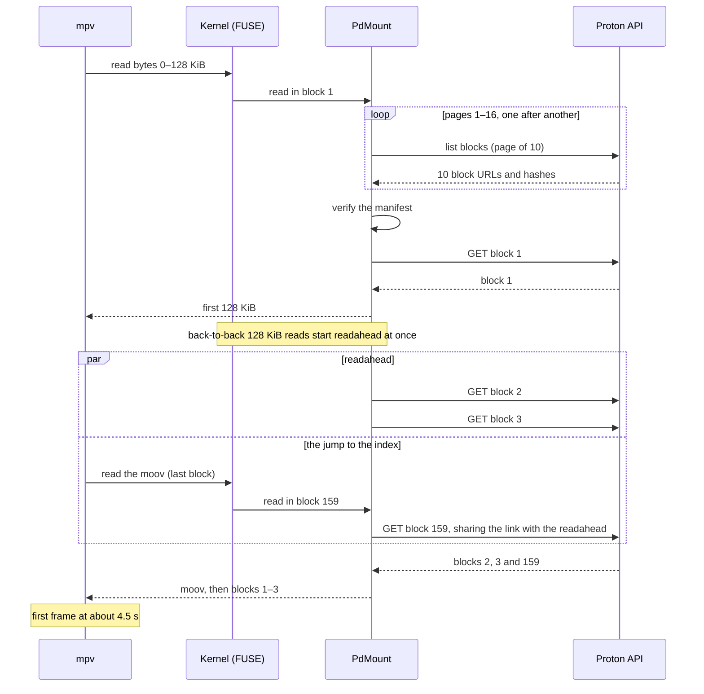
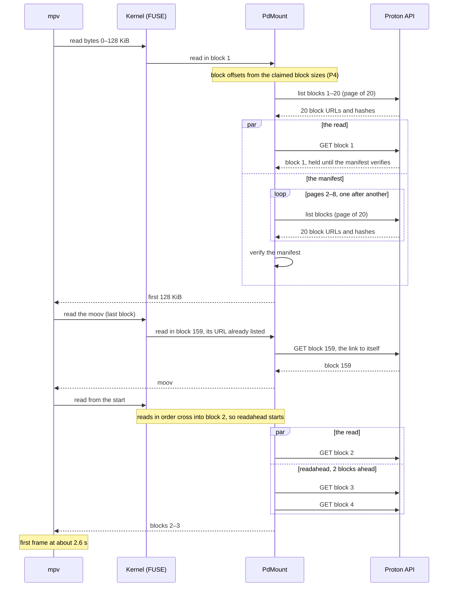
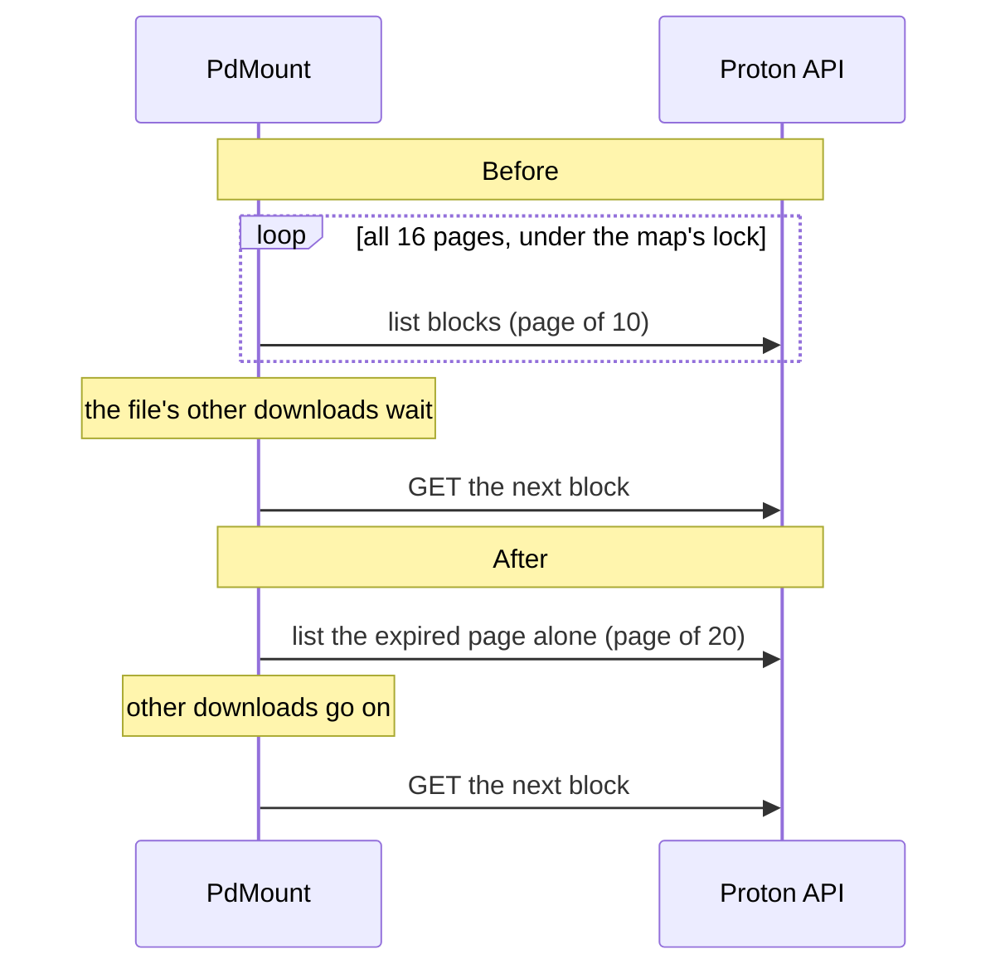
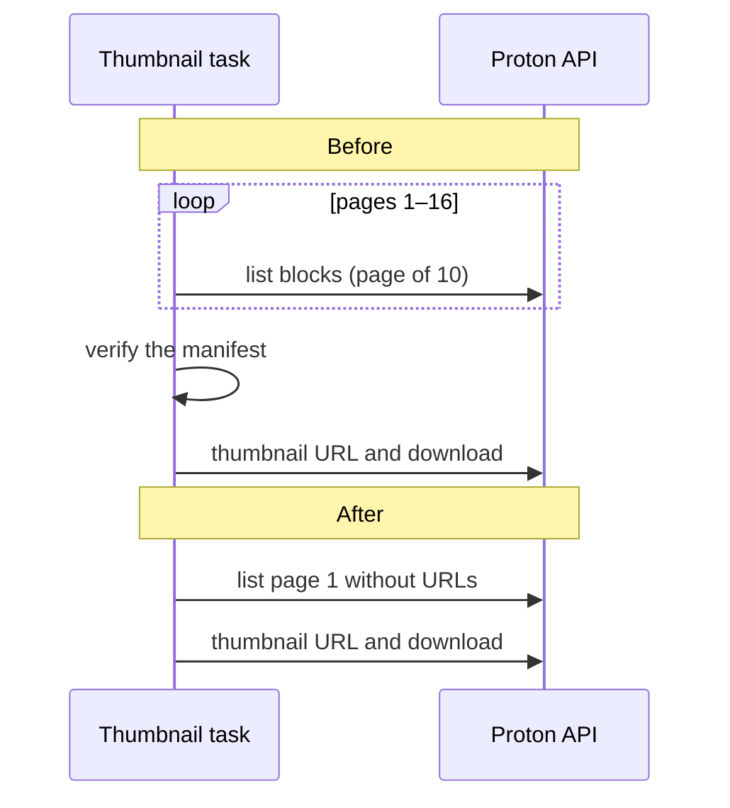

# Large-file request flow, before and after M6.0.11

How PdMount turns mpv's reads of a 633 MiB MP4 into Proton Drive API requests. The file has 159 blocks of 4 MiB, with
its index (`moov`) at the end. Before is pin `10a4471`; after is `19cc34d` (fork P30, D135; DESIGN §5.3, §6.1, §14.5).

| | Before | After |
|---|---|---|
| First frame, median on the real account (9 / 7 runs) | 4.5 s | 2.6 s |
| Block-list requests before the first byte (pages of 10 → 20) | 16 | 8 |
| Requests before block 1's download starts | 16 | 1 |
| Requests for this video's thumbnail (Photos) | 16 | 1 |

The timelines below are schematic, not a captured trace. Bars use 0.2 s per block-list page (the real account measured
73–400 ms) and about 0.35 s per 4 MiB block, and the first-frame times are set to the measured medians. In the Gantt
charts, plain bars are block-list pages, red bars (`crit`) are downloads a read waits for, light bars (`active`) are
readahead, and grey bars (`done`) are mpv waiting.

## 1. Opening the video: mpv's first frame

mpv reads the first 128 KiB, jumps to the index in the last block, then reads from the start. It needs three blocks
before the first frame.

### Before: the whole listing first, readahead at once

```mermaid
gantt
    title Before: first frame at 4.5 s
    dateFormat x
    axisFormat %S.%L s
    section Block list
    Page 1        :0, 200
    Page 2        :200, 400
    Page 3        :400, 600
    Page 4        :600, 800
    Page 5        :800, 1000
    Page 6        :1000, 1200
    Page 7        :1200, 1400
    Page 8        :1400, 1600
    Page 9        :1600, 1800
    Page 10       :1800, 2000
    Page 11       :2000, 2200
    Page 12       :2200, 2400
    Page 13       :2400, 2600
    Page 14       :2600, 2800
    Page 15       :2800, 3000
    Page 16       :3000, 3200
    Manifest verified :milestone, 3200, 3200
    section Downloads
    Block 1 (read)        :crit, 3200, 3550
    Block 2 (readahead)   :active, 3560, 4300
    Block 3 (readahead)   :active, 3560, 4330
    Block 159 (read)      :crit, 3580, 4450
    section mpv
    Waits for the head    :done, 0, 3550
    Waits for the moov    :done, 3580, 4450
    First frame           :milestone, 4500, 4500
```

1. The read in block 1 asks for the block map, and every page is listed in turn: 16 requests of 10 blocks each.
2. The manifest is verified, then block 1 is downloaded.
3. The kernel's back-to-back 128 KiB reads start readahead at once, for blocks 2 and 3.
4. mpv's jump to the last block shares the connection with that readahead.

### After: list by range, the manifest beside the download, readahead held

```mermaid
gantt
    title After: first frame at 2.6 s
    dateFormat x
    axisFormat %S.%L s
    section Block list
    Page 1 (for the read)     :0, 200
    Page 2 (manifest)         :200, 400
    Page 3 (manifest)         :400, 600
    Page 4 (manifest)         :600, 800
    Page 5 (manifest)         :800, 1000
    Page 6 (manifest)         :1000, 1200
    Page 7 (manifest)         :1200, 1400
    Page 8 (manifest)         :1400, 1600
    Manifest verified and head given :milestone, 1600, 1600
    section Downloads
    Block 1 (read)        :crit, 200, 550
    Block 159 (read)      :crit, 1620, 1970
    Block 2 (read)        :crit, 2000, 2400
    Block 3 (readahead)   :active, 2000, 2500
    Block 4 (readahead)   :active, 2000, 2550
    section mpv
    Waits for the head    :done, 0, 1600
    Waits for the moov    :done, 1620, 1970
    Waits for blocks 2–3  :done, 1990, 2600
    First frame           :milestone, 2600, 2600
```

1. The read in block 1 lists only its own page (blocks 1–20). Its download starts at once, with offsets from the
   claimed block sizes.
2. Beside it, pages 2–8 are listed one by one so that the manifest can be verified. Block 1's bytes are given only after
   that, so S-4 (P17) stays closed.
3. The jump to block 159 finds its URL already listed and has the connection to itself.
4. Readahead starts when reads in order cross into block 2: 2 blocks ahead, then 4.

## 2. Playing on in Photos

The Photos tree had no readahead, so playback fetched one block per round trip. It now uses the engine's detector and
the session's two readahead permits. Six blocks of sequential playback, at 80 ms round trip and 20 MB/s (schematic):

```mermaid
gantt
    title Before: one block at a time, 6 blocks at 1.74 s
    dateFormat x
    axisFormat %S.%L s
    section Downloads
    Block 1 (read)    :crit, 0, 290
    Block 2 (read)    :crit, 290, 580
    Block 3 (read)    :crit, 580, 870
    Block 4 (read)    :crit, 870, 1160
    Block 5 (read)    :crit, 1160, 1450
    Block 6 (read)    :crit, 1450, 1740
```

```mermaid
gantt
    title After: readahead 2, then 4 blocks ahead, 6 blocks at 1.02 s
    dateFormat x
    axisFormat %S.%L s
    section Downloads
    Block 1 (read)        :crit, 0, 290
    Block 2 (read)        :crit, 290, 580
    Block 3 (readahead)   :active, 290, 720
    Block 4 (readahead)   :active, 290, 740
    Block 5 (readahead)   :active, 720, 1000
    Block 6 (readahead)   :active, 740, 1020
```

On the fake, a 256 MiB copy from Photos went from 21.7 s to 15.8 s.

## 3. After 10 minutes: an expired block list

Before, the block map expired as a whole after 10 minutes. The next block's read listed all 16 pages again, and the
file's other downloads waited behind that lock. Now each page expires on its own and is listed again alone. Its hashes
are already verified, so no manifest is needed.

## 4. A video's thumbnail (Photos)

Before, the thumbnail task listed every block of every video to reach the manifest: 16 requests for this video, in the
background. Now it costs one request, the first page without block URLs (`NoBlockUrls`). Below 20 blocks that page is
the whole listing, so the manifest is still verified. For larger videos, the thumbnail is checked only by decryption,
as the official clients check every thumbnail.

## Requests per file size

| File | Blocks | Before: list requests before the first byte | After: before the first byte | After: before block 1's download starts |
|---|---|---|---|---|
| 633 MiB video (this test) | 159 | 16 | 8 | 1 |
| ~650 MiB phone MP4 | 163 | 17 | 9 | 1 |
| 2 GiB | 512 | 52 | 26 | 1 |
| 4.9 GiB | 1255 | 126 | 63 | 1 |

## Measured

| Case | Before | After |
|---|---|---|
| Real account, My Files: first frame (mpv) | 2.4–7.3 s, median 4.5 | 1.5–4.0 s, median 2.6 |
| Real account: 10 s of playback | 14.1 s | 12.3 s |
| Real account: full copy (633 MiB) | 36–51 s | 43–44 s |
| Real account: block-list page of 20 | — | 73–400 ms, 20 blocks each |
| Fake, 80 ms, 20 MB/s: first frame | 2.2–2.7 s | 1.5–2.0 s |
| Fake, 80 ms, 5 MB/s: first frame | 4.2–6.0 s | 3.4–4.0 s |
| Fake, 80 ms, 2 MB/s: first frame | 7–9 s | 7–9 s (bound by the transfer) |
| Fake, Photos, 20 MB/s: 256 MiB copy | 21.7 s | 15.8 s |

The real-account runs used My Files, because the test account's Photos holds no video. Each run started with a fresh
daemon and the video's blocks wiped. The full results are in D135.
